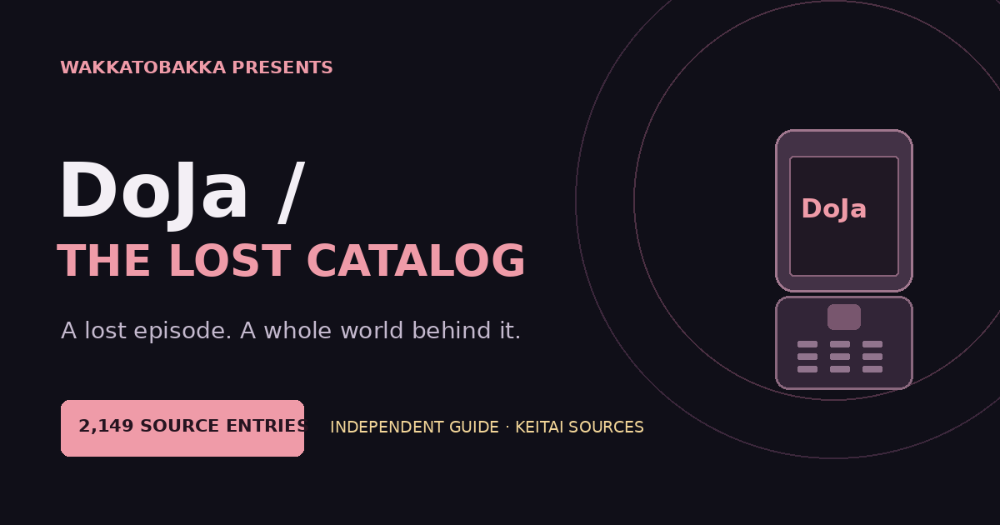

# DoJa / The Lost Catalog

**A lost episode. A whole world behind it.**

An independent, searchable DoJa discovery catalog by Wakkatobakka, built from credited Keitai World Launcher metadata. Dirge of Cerberus: Lost Episode—the game that started Wakka's Android bridge work—gets the featured place in a much wider collection of Japanese mobile history.

[**Browse the catalog →**](https://wakkatobakka.github.io/doja-archive/) · [Keitai Archive](https://keitaiarchive.org/) · [Keitai World Launcher](https://keitaiarchive.org/downloads.html) · [Sources](data/SOURCES.md)



## What's here

- **2,149 source-listed DoJa entries**, grouped conservatively into **2,067 title and application records**.
- Every original English/Japanese title field and package label retained, with individual edition sections and source-listed device/version variants.
- **61 English-patch entries, 26 Chinese-patch entries, 109 explicit trial/demo labels**, and **9 entries with a separate SD-data reference**.
- Search across names, Japanese titles, filenames, and source variants; filter by edition and SD-data reference; sort titles or source-entry counts.
- Browsing in pages of 60 records, with shareable query/filter/page URLs. Without JavaScript, every record remains accessible in the HTML.
- Dirge's standard source listing, trial, and English-patch listing share a page, with separate SD-data references preserved.
- CSV/JSON exports, a runtime-classification audit, an offline builder, and a verifier using only Python's standard library.

The snapshot was reviewed **October 30, 2026**. Only entries explicitly labeled `doja` in the launcher metadata are included; STAR and other platform families stay outside the catalog. Counts describe source listings and grouped names, not a complete inventory of unique retail games. Applications and utilities are included where the source labels them DoJa.

Game packages and SD-data archives were not downloaded, inspected, or tested for this index. The site points readers to the original projects to locate the matching editions. Individual source variant labels, including “Patched” or “Non-Working,” remain attributed source text.

## Publish on GitHub

Repository: **`doja-archive`**  
Account: **`Wakkatobakka`**

1. Extract the ZIP and open the enclosed **`doja-archive`** folder.
2. Create a public GitHub repository named **`doja-archive`**. Leave automatic README, license, and gitignore creation unchecked; these files are included.
3. Copy the folder's **contents** into your repository folder. `index.html`, `assets/`, `games/`, `about/`, `data/`, and `tools/` belong directly in the repository root.
4. Commit and push to **`main`**. In GitHub Desktop, copy the contents into the repository's local folder, commit, then **Push origin** or **Publish repository**.
5. Open **Settings → Pages → Deploy from a branch → main → /(root) → Save**.

Expected address after GitHub deploys:

**https://wakkatobakka.github.io/doja-archive/**

Extract the ZIP before adding files. Uploading only the ZIP will not publish the unpacked site. No build service, API keys, external scripts, or paid hosting are required.

Open `index.html` to preview locally. Page links use explicit HTML filenames. In some local browsers, a metadata download button opens the file instead of saving it.

## Metadata exports

| File | Contents |
| --- | --- |
| `data/catalog.csv` | One row per grouped browsing record |
| `data/entries.csv` | All 2,149 included source entries, with exact labels |
| `data/classification.csv` | All 2,818 launcher rows and the include/exclude decision |
| `data/catalog.json` | Canonical catalog, source fingerprints, counts, grouping rules, and individual entries |

## Rebuild or update

For lasting local edits, change **`data/catalog.json`** and keep the documented source evidence with the change. Then run:

```sh
python3 tools/build_site.py
python3 tools/verify.py
```

Both commands run offline with the Python standard library. The builder regenerates pages and metadata exports. Source classification lives in `data/classification.csv`; updates to inclusion or source identifiers must keep that audit consistent. The verifier reconciles the audit, data exports, source entry counts, page coverage, and local links and anchors.

To explicitly refresh from the two public metadata endpoints:

```sh
python3 tools/refresh_catalog.py
```

This fetches **metadata only**, imports a new snapshot, and runs build/verification. It replaces canonical source-derived fields; preserve any manual additions before refreshing and review the Git diff before committing. It never retrieves games, SD-data packages, artwork, or SDKs. If the source endpoint changes, verify its new address through the original project before editing the refresh script.

For a local metadata import:

```sh
python3 tools/import_catalog.py --gamelist /path/to/gamelist.xml --website-csv /path/to/searchable_media.csv
python3 tools/build_site.py
python3 tools/verify.py
```

See [data/SCHEMA.md](data/SCHEMA.md) for field definitions and grouping rules. Rebuilding does not refresh sources or imply a new source-review date. Site identity is set in `repository` and `site_url` in `catalog.json`; change those before rebuilding for another account/repository.

## Credits

Original preservation, recovery, translations, and launcher work belong to **Keitai Archive, the Keitai World community, Yuvi, and their credited contributors**. [Keitai Wiki](https://keitaiwiki.com/) documents the broader history. Per-entry contributor names are not supplied by the launcher catalog and are not invented here.

Dirge's featured history links to [Yuvi's firsthand account of restoring the full release](https://medium.com/@yuviapp/the-story-to-save-a-couple-of-lost-keitai-games-1be4ede27c75), which credits Naoya Shinota and other contributors. Wakka's [Dirge Bridge](https://github.com/Wakkatobakka/Dirge-Bridge) is a separate downstream Android project.

[Contributions and credit corrections](CONTRIBUTING.md) are welcome. Include the record ID, exact source-entry title, and supporting reference.

Companion catalogs: [Qualcomm BREW](https://wakkatobakka.github.io/qualcomm-brew-archive/) · [Zeebo](https://wakkatobakka.github.io/zeebo-archive/) · [ExEn](https://wakkatobakka.github.io/exen-game-archive/).

Independent catalog by Wakkatobakka. No affiliation with NTT DoCoMo, game rights holders, or the source projects. Original site code is MIT licensed; the license does not cover games, translations, trademarks, or third-party materials. No original game binaries, SDKs, source-site artwork, or source-site prose are bundled.
